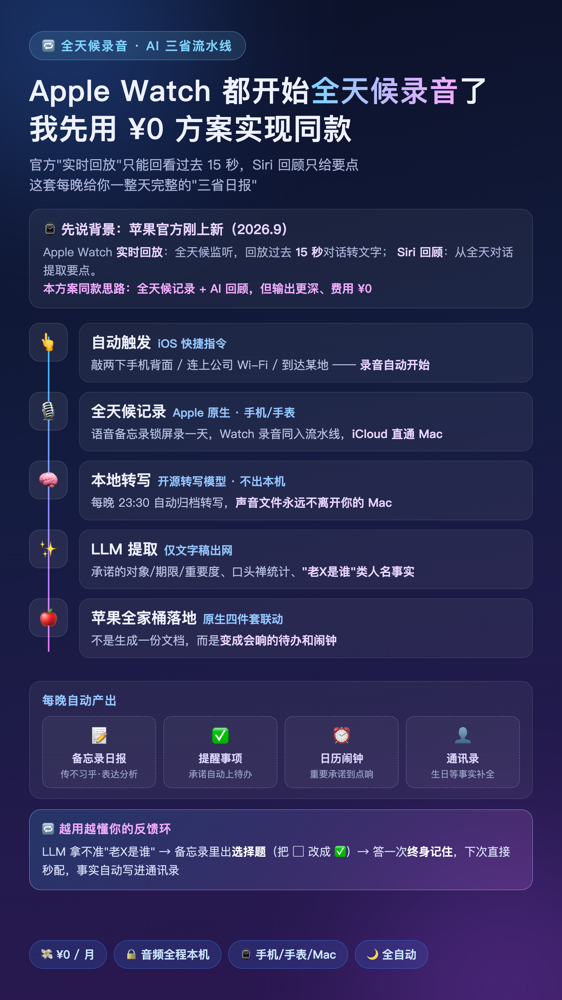
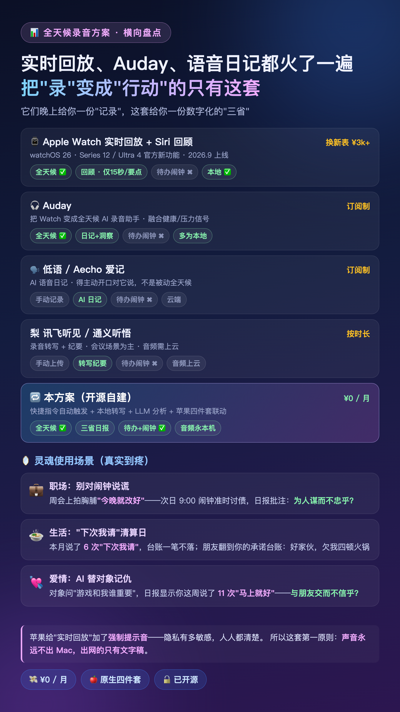

# 🔁 君子吾日三省 — 敲两下手机背面，AI 帮你三省吾身

> **全天候录音 → 本地转写 → LLM 分析 → 苹果四件套自动联动**
> 曾子说吾日三省吾身。两千五百年后，工具终于配得上这句话了。



## 🎯 这是什么

Apple Watch 刚上线"实时回放"（全天候监听，回放过去 15 秒）和 Siri 回顾，Auday 们把全天候录音做成了订阅制 App。这套开源方案用你已有的设备实现同款——而且走得更深：

- 官方只回放 15 秒、给要点；这套每晚给你**完整的三省日报**：口头禅统计、表达模式、为人谋 / 朋友交 / 传习乎三问
- 别人给你一份"记录"；这套把承诺**变成会响的待办和闹钟**
- 全程 **¥0/月**，音频**永不出你的 Mac**，出网的只有文字稿

## 🪞 灵魂使用场景（真实到疼）

- 💼 **职场**：周会上拍胸脯"今晚就改好"——次日 9:00 闹钟准时讨债，日报批注：*为人谋而不忠乎？*
- 🍲 **生活**："下次我请"本月说了 6 次，台账一笔不落；朋友翻到你的承诺台账：好家伙，欠我四顿火锅
- 💘 **爱情**：对象问"游戏和我谁重要"，日报显示你这周说了 11 次"马上就好"——*与朋友交而不信乎？*

## ⚙️ 工作流

```
iOS快捷指令自动触发(敲背面/到地点/连WiFi) → 语音备忘录全天候记录
  → iCloud 同步 → Mac 本地开源转写(音频不出本机) → LLM 提取
  → 📝 备忘录日报  ✅ 提醒事项  ⏰ 日历闹钟  👤 通讯录补全
  → 联系人有歧义? 备忘录出选择题, 答 ✅ 一次终身记住(越用越懂你)
```

## 📊 横向对照

| 方案 | 全天候采集 | AI 回顾 | 承诺→待办/闹钟 | 音频不出设备 | 费用 |
|---|---|---|---|---|---|
| ⌚ Apple Watch 实时回放+Siri回顾 | ✅（回放仅15秒） | 要点 | ❌ | ✅ | 换新表 ¥3k+ |
| 🎧 Auday | ✅ | 日记+洞察 | ❌ | 多为本地 | 订阅制 |
| 🗣️ 低语 / Aecho 爱记 | ❌ 手动 | AI 日记 | ❌ | 云端 | 订阅制 |
| 🍐 讯飞听见 / 通义听悟 | ❌ 手动 | 转写纪要 | ❌ | 音频上云 | 按时长 |
| 🔁 **三省（本方案）** | ✅ 自动触发 | **三省日报** | ✅ | ✅ 永本机 | **¥0/月** |



## ⚡ 快速开始

**准备**：一台 macOS 13+ 的 Mac（常开或晚间开机）+ iPhone 与 Mac 登录同一 iCloud，开启"语音备忘录"iCloud 同步。

```bash
# 1. 安装依赖
brew install whisper-cpp ffmpeg

# 2. 下载中文转写模型(1.5GB, 国内镜像)
curl -L -o ~/sanxing/models/ggml-large-v3-turbo.bin --create-dirs \
  https://hf-mirror.com/ggerganov/whisper.cpp/resolve/main/ggml-large-v3-turbo.bin

# 3. 安装
git clone https://github.com/lumiakey/junzi-wuri-sanxing.git && cd junzi-wuri-sanxing
bash setup.sh
```

安装器会引导完成 3 步手动授权（完全磁盘访问 → 备忘录写 API Key → 首跑允许自动化弹窗），之后每晚 23:30 全自动。

**iPhone 侧（可选但推荐）**：快捷指令建三条自动化——到达某地 / 连上公司 Wi-Fi / 轻点背面两下 → 打开语音备忘录。触发即录，录完揣兜里锁屏不断。

**LLM 配置**：任意兼容 OpenAI 接口的服务均可（`config.env` 改 `GLM_MODEL` / `GLM_BASE`），默认走有免费额度的 glm-4-flash。API Key 写在备忘录任意笔记里一行 `GLM_API_KEY=xxx`，换 Key 无需碰 Mac。

## 🔐 隐私设计

苹果给"实时回放"加了**强制提示音**——全天候录音的隐私敏感度，人人都清楚。所以本项目的第一原则：

- 录音与转写**全程本地**（开源 whisper.cpp），声音文件永远不离开你的 Mac
- 唯一出网的是转写后的**文字稿**（发给 LLM 做结构化提取）
- 备忘录/提醒事项/日历/通讯录全部通过本机 AppleScript 操作，云端模型不接触
- 撤销授权入口：系统设置 → 隐私与安全性 → 自动化 / 完全磁盘访问权限

## 🗂 目录结构

```
bin/run.sh            主流水线(发现→归档→转写→分析→发布)
bin/analyze.py        LLM 提取: 承诺/记住的事/联系人事实/三省
bin/publish_note.py   日报渲染器(汇总当日全部录音)
bin/contacts_lib.py   联系人关联+别名学习+确认笔记
bin/resolve_mentions.py  消化确认笔记里的回答
bin/as_*.applescript  苹果四件套脚本接口
setup.sh / uninstall.sh
```

数据全部落在 `~/sanxing/data/`（已 gitignore），随时可删可迁移。

## ⚠️ 免责声明

录音涉及他人时请遵守当地法律法规，尊重对话方意愿，涉密与敏感场合请勿录制。本项目仅供个人学习与自省使用。

## 📄 License

MIT
