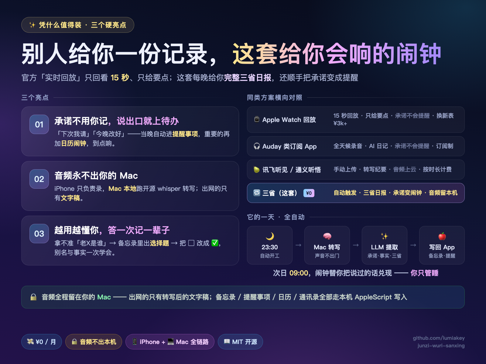
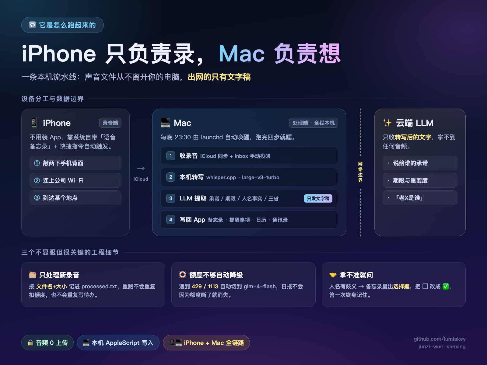
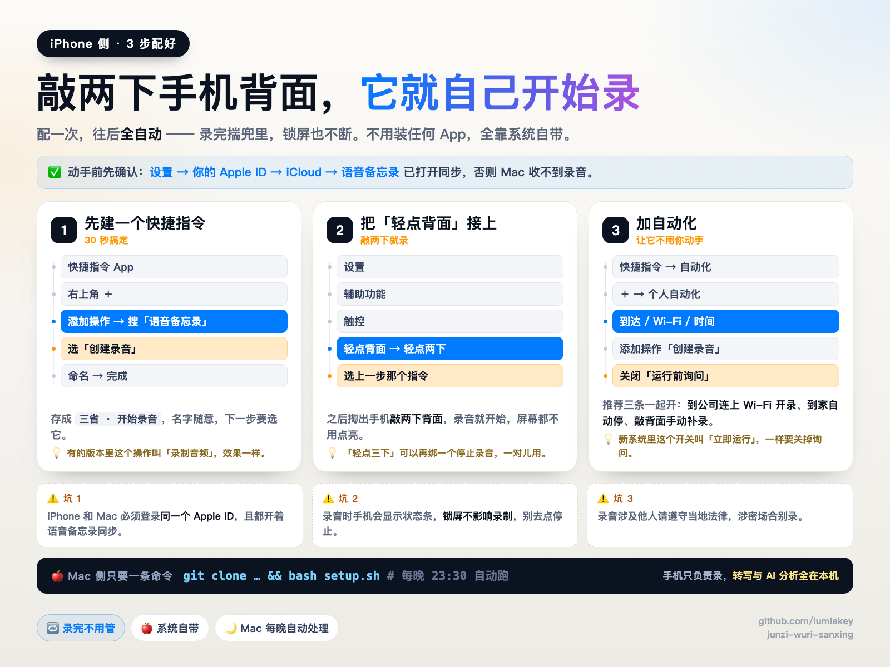

# 🔁 君子吾日三省 — 敲两下手机背面，AI 帮你三省吾身

> **iPhone 负责录 · Mac 负责想 · 备忘录 / 提醒事项 / 日历 / 通讯录自动落地**
> 曾子说吾日三省吾身。两千五百年后，工具终于配得上这句话了。

<p align="center">
  
  
</p>

<p align="center">
  <b>¥0/月</b> · <b>音频不出本机</b> · <b>macOS 13+</b> · <b>MIT</b> · <b>一条命令装完</b>
</p>

---

## 🎯 这是什么

Apple Watch 刚上线「实时回放」（全天候监听，回放过去 15 秒）和 Siri 回顾，Auday 们把全天候录音做成了订阅制 App。这套开源方案用你**已有的设备**实现同款 —— 而且走得更深：

- 官方只回放 15 秒、只给要点；这套每晚给你**完整的三省日报**：口头禅统计、表达模式、为人谋 / 朋友交 / 传习乎三问
- 别人给你一份「记录」；这套把承诺**变成会响的待办和闹钟**
- iPhone 只管录，转写与分析全在你 **Mac 本机**跑，**¥0/月**，出网的只有文字稿

## 🪞 三个真实到疼的场景

| 场景 | 你当时说的话 | 当晚它变成 |
|---|---|---|
| 💼 **周一晨会** 10:14 | 「今晚肯定改好发您」 | 次日 **09:00** 闹钟准时讨债，日报批注：*为人谋而不忠乎？* |
| 🍻 **朋友饭局** 19:38 | 「下次我请，一定」 | 台账第 **6** 次「下次我请」，朋友翻到：好家伙，欠我四顿火锅 |
| 💘 **对象查岗** 22:51 | 「马上就好，真的」 | 本周第 **11** 次「马上就好」，日报批注：*与朋友交而不信乎？* |

## ⚙️ 它是怎么跑起来的

<p align="center">
  
</p>

**设备分工**：iPhone 只负责录（敲背面 / 连 Wi-Fi / 到地点，快捷指令自动触发）；Mac 负责想（收录音 → 本机转写 → LLM 提取 → 写回 App），每晚 23:30 由 launchd 自动唤醒。

**数据边界**：音频与转写稿全程留在 Mac；唯一出网的是**转写后的文字**，发给 LLM 做结构化提取。备忘录 / 提醒事项 / 日历 / 通讯录全部通过本机 AppleScript 写入，云端模型碰不到。

## ✨ 三个亮点

1. **承诺不用你记** ——「下次我请」「今晚改好」当晚自动进提醒事项，重要的再加日历闹钟，到点响
2. **音频永不出你的 Mac** —— iPhone 只负责录，Mac 本地跑开源 whisper.cpp，出网的只有文字稿
3. **越用越懂你** —— 拿不准「老X是谁」→ 备忘录里出选择题 → 把 ▢ 改成 ✅，别名与事实一次学会，终身记住

## 📊 横向对照

| 方案 | 全天候采集 | AI 回顾 | 承诺→待办/闹钟 | 音频不出设备 | 费用 |
|---|---|---|---|---|---|
| ⌚ Apple Watch 实时回放 + Siri 回顾 | ✅（回放仅 15 秒） | 要点 | ❌ | ✅ | 换新表 ¥3k+ |
| 🎧 Auday | ✅ | 日记 + 洞察 | ❌ | 多为本地 | 订阅制 |
| 🗣️ 低语 / Aecho 爱记 | ❌ 手动 | AI 日记 | ❌ | 云端 | 订阅制 |
| 🍐 讯飞听见 / 通义听悟 | ❌ 手动 | 转写纪要 | ❌ | 音频上云 | 按时长 |
| 🔁 **三省（本方案）** | ✅ 自动触发 | **三省日报** | ✅ | ✅ 永本机 | **¥0/月** |

## ⚡ 快速开始

**准备**：一台 macOS 13+ 的 Mac（常开或晚间开机）+ iPhone 与 Mac 登录同一 Apple ID，并开启「语音备忘录」iCloud 同步。

```bash
# 1. 安装依赖
brew install whisper-cpp ffmpeg

# 2. 下载中文转写模型（1.5GB，国内镜像）
curl -L -o ~/sanxing/models/ggml-large-v3-turbo.bin --create-dirs \
  https://hf-mirror.com/ggerganov/whisper.cpp/resolve/main/ggml-large-v3-turbo.bin

# 3. 安装
git clone https://github.com/lumiakey/junzi-wuri-sanxing.git && cd junzi-wuri-sanxing
bash setup.sh
```

安装器会引导完成 **3 步手动授权**，之后每晚 23:30 全自动：

1. 系统设置 → 隐私与安全性 → **完全磁盘访问权限** → 添加 `~/sanxing/bin/sanxing-bash`
2. 备忘录任意笔记写一行 `GLM_API_KEY=你的Key`（换 Key 不用碰 Mac）
3. 双击 `~/sanxing/立即处理.command`，首次弹出的自动化授权**全部允许**

**iPhone 侧（3 步，配一次终身用）**

<p align="center">
  
</p>

1. 快捷指令 → ＋ → 添加操作 → 搜「语音备忘录」→ 选「创建录音」，存成 `三省 · 开始录音`
2. 设置 → 辅助功能 → 触控 → 轻点背面 → 轻点两下 → 选它
3. 快捷指令 → 自动化 → ＋ → 选「到达 / Wi-Fi / 时间」→ 添加「创建录音」→ 关闭「运行前询问」

**LLM 配置**：任意兼容 OpenAI 接口的服务均可（`config.env` 改 `GLM_MODEL` / `GLM_BASE`），默认走有免费额度的 `glm-4-flash`；额度不足会自动降级，日报不中断。

## 🤖 让 AI 帮你装

不想自己敲命令？把仓库地址丢给任意 AI Agent：

> 读 `AGENTS.md`，按里面的步骤帮我把三省装好。

[`AGENTS.md`](AGENTS.md) 是给 LLM 的操作手册：前置条件核对、3 条安装命令、哪些权限必须人来点、5 项自检、9 条故障对照表，读完就能动手。

## 🔐 隐私设计

苹果给「实时回放」加了**强制提示音** —— 全天候录音的隐私敏感度，人人都清楚。所以本项目的第一原则：

- 录音与转写**全程本地**（开源 whisper.cpp），声音文件永远不离开你的 Mac
- 唯一出网的是转写后的**文字稿**（发给 LLM 做结构化提取）
- 备忘录 / 提醒事项 / 日历 / 通讯录全部通过本机 AppleScript 操作，云端模型不接触
- 撤销授权入口：系统设置 → 隐私与安全性 → 自动化 / 完全磁盘访问权限

## 🗂 目录结构

```
bin/run.sh                主流水线(发现→归档→转写→分析→发布)
bin/analyze.py            LLM 提取: 承诺/记住的事/联系人事实/三省
bin/publish_note.py       日报渲染器(汇总当日全部录音)
bin/contacts_lib.py       联系人关联+别名学习+确认笔记
bin/resolve_mentions.py   消化确认笔记里的回答
bin/as_*.applescript      备忘录/提醒事项/日历/通讯录的本机脚本接口
setup.sh / uninstall.sh   安装 / 卸载
AGENTS.md                 给 AI Agent 的启动与排障手册
docs/assets/              宣传图（4:3 用于 README，9:16 用于发帖）
```

数据全部落在 `~/sanxing/data/`（已 gitignore），随时可删可迁移。

## 🧰 常见问题

| 症状 | 原因 | 修法 |
|---|---|---|
| 提示「未读到语音备忘录录音」 | `sanxing-bash` 没拿到完全磁盘访问权限 | 重做授权第 1 步；确认执行者不是普通 `bash` |
| 录音有，但没被处理 | 只扫近 **2 天**（iCloud 会把 mtime 重置，按文件名日期判断） | 把文件放进 `~/sanxing/data/inbox/`，不限时间 |
| 备忘录没有日报 | 当天没有分析数据 | 看 `~/sanxing/logs/run-*.log` 最新一条 |
| 日报有，但没有待办 | LLM 未返回（Key 无效 / 额度用尽 / 语料 < 10 字） | 查日志里的 `GLM分析失败`；太短的录音会被跳过 |

完整排障见 [`AGENTS.md`](AGENTS.md) 第 9 节。

## ⚠️ 免责声明

录音涉及他人时请遵守当地法律法规，尊重对话方意愿，涉密与敏感场合请勿录制。本项目仅供个人学习与自省使用。

## 📄 License

MIT
